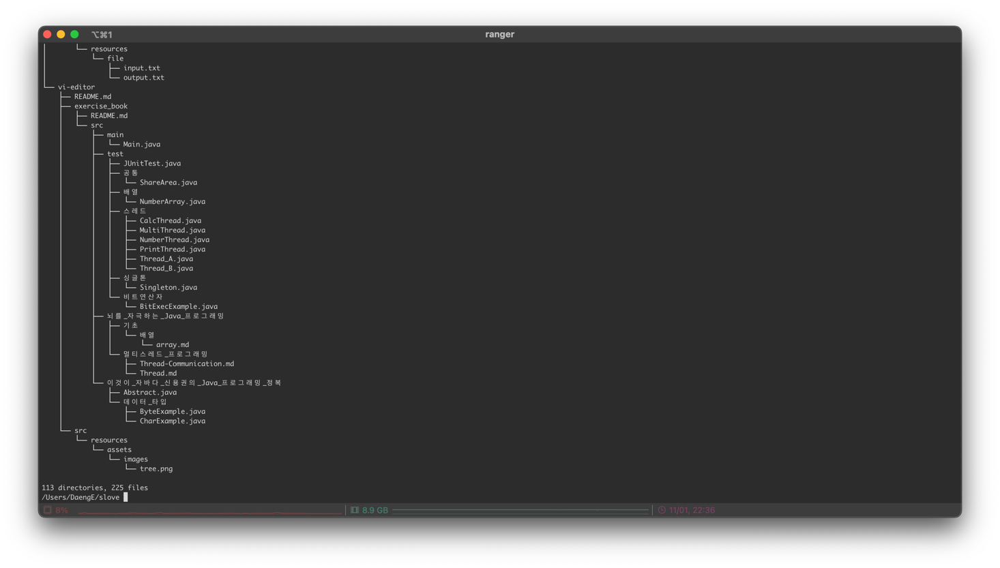
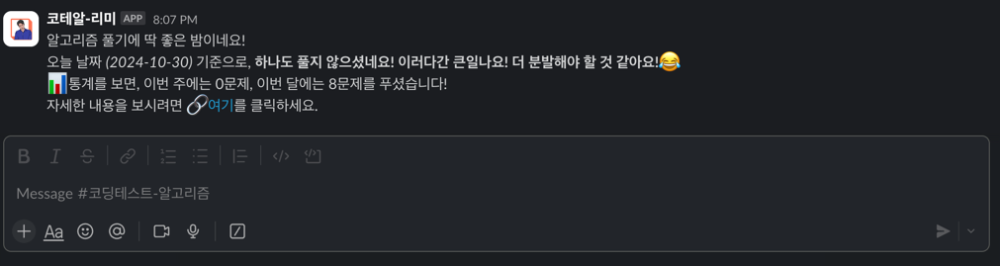

<div align="center">

# 백준 알고리즘


</div>

### ✏️작성 취지
- 알고리즘 해결과정 및 고충 정리
- 파일 이력관리
- 빠른 디버깅, 실행 결과 도출
- 자료구조 공부 (Iterator, Map, Stream)
- 깔끔한 주석 템플릿

### 📊 풀이 현황
> 2026-09-08 기준 (커밋 191개, 2024-03-13 ~ 2025-07-14). 풀이를 추가하면 수치가 달라집니다.

총 **82개** (백준 74개 + 알고리즘 공부 8개)

| 카테고리 | 경로 | 개수 |
|---|---|---|
| 수학 | `baekjoon/math` | 35 |
| 구현 | `baekjoon/Implementation` | 32 |
| 스택 | `baekjoon/stack` | 2 |
| 문자열 | `baekjoon/string` | 1 |
| 정렬 | `baekjoon/sort` | 1 |
| 누적합 | `baekjoon/prefix_sum` | 1 |
| 다이나믹 프로그래밍 | `baekjoon/dynamic_programming` | 1 |
| 임의 정밀도 | `baekjoon/arbitrary_precision` | 1 |
| 재귀 | `algorithm/recursion/*` | 4 |
| 정렬 알고리즘 | `bjpublic/javarithms/sort` | 4 |

수학·구현이 67개로 전체의 약 82%를 차지합니다. 그래프, 그리디, BFS/DFS는 아직 풀이가 없습니다.

### 💻구성
- Java JDK 8 ( corretto 1.8 )
- Zed (Java 확장, 언어 서버 jdtls)
- Gitkraken
- ~~IntelliJ IDEA~~
- ~~Gradle~~
- ~~SpringBoot2.x.x~~
- ~~Swagger UI~~
- Slack Incoming Webhook + GitHub Actions
- 카카오톡 "나에게 보내기" (Claude 예약 작업)

### 🗂️폴더 구조
```
src/com/test/coding/
├── baekjoon/                  # 백준 문제 풀이 (카테고리별 분류, $_문제번호.java)
│   ├── math/
│   ├── Implementation/
│   ├── stack/
│   ├── string/
│   ├── sort/
│   ├── prefix_sum/
│   ├── dynamic_programming/
│   └── arbitrary_precision/
├── algorithm/recursion/       # 알고리즘 개념 공부 (재귀)
│   └── array/ · binarySearch/ · sequentialSearch/ · string/
└── bjpublic/javarithms/sort/  # 정렬 알고리즘 학습 (Bubble/Insertion/Merge/Selection)
```
- 

### 👨‍💻구현 방식
1. 백준 알고리즘에서 제시한 입력 데이터를 input.txt 입력
2. 코딩
3. 올바른 값이 output.txt 출력되었는지 확인

> 모든 파일이 `package com.test.coding.baekjoon.xxx;` 형태라서, 실행할 때는 `src`를 소스 루트로 두고 패키지까지 포함한 클래스명으로 실행해야 합니다.
> ```bash
> javac -d out -sourcepath src src/com/test/coding/baekjoon/math/\$_1000.java
> java -cp out com.test.coding.baekjoon.math.\$_1000 < input.txt
> ```

### 🔔 자동 알림
풀이 현황을 정해진 시각에 나에게 알려줍니다.

| 방식 | 주기 | 내용 |
|---|---|---|
| Slack · `daily-algorithm-alert.yml` | 월~금, KST 20:17 | 어제 푼 문제 수 + 7일/30일 누적 |
| Slack · `weekly-algorithm-alert.yml` | 금요일, KST 18:17 | 최근 6개월 누적 |
| 카카오톡 · Claude 예약 작업 (시험 운영 중) | 월~금, KST 20:17 | daily와 같은 내용을 200자 이내 텍스트로 전송 |

**Slack 설정**
- `.github/workflows/`의 GitHub Actions가 `secrets.SLACK_WEBHOOKS_URL`(Incoming Webhook)로 전송합니다.
- 두 워크플로우 모두 Actions 탭의 `Run workflow` 버튼으로 수동 실행할 수 있습니다 (`workflow_dispatch`).
- cron을 정각이 아닌 17분으로 둔 건 정각에 GitHub 스케줄이 몰려 실행이 지연되거나 누락되는 일을 피하려는 것입니다.

**알림이 오지 않을 때**
- 저장소에 60일 이상 커밋이 없으면 GitHub이 예약 워크플로우를 자동으로 끕니다. 커밋을 새로 올려도 다시 켜지지 않으니 Actions 탭에서 해당 워크플로우의 `Enable workflow`를 직접 눌러야 합니다.
- Actions 실행 기록에 `The job was not acquired by Runner` 같은 오류가 있으면 GitHub 쪽 일시 장애입니다. `Re-run failed jobs`로 다시 실행합니다.
- 수동 실행에서는 성공하는데 Slack에 안 오면 Webhook URL이 무효화됐을 수 있으니 Settings → Secrets and variables → Actions의 `SLACK_WEBHOOKS_URL`을 확인합니다.

### ⚠️주의사항
- 문제를 대충 보지 않는다.
- **입출력**을 정확하게 이해한다.
- 어떻게 **구현**해야 할지 생각한다.
- **오탈자**를 확인한다.
- 예외를 처리한다.
- **디버깅**을 한다.

- **반례**를 스스로 찾아낼 수 있어야한다.
- 한 문제에 **많은 시간**을 할애하지 않는다.
  - 하지만, 포기하지 않고 충분히 고민은 해본다. 남들이 구현한 방식을 참고하는 것도 중요하다. 똑같이는 구현하지 않고 최대한 개성있고 최적화하여 가독성이 좋도록 한다.
  - 현재 한 문제에 가장 오래걸린 시간은 **2일**이다.
- 다양한 접근방식을 생각한다. 너무 깊게도 얇게도 생각하지 않는다. 예상외에 답이 나올 수 있는 방법이 있다.

### 📋추가 예정
- [X] 알고리즘 풀이 주간, 월간 통계・결산하여 알림 서비스


